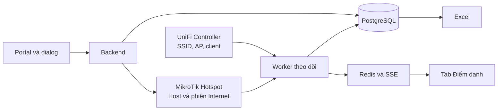

**Thiết kế hệ thống WiFi và Điểm danh họp tầng 11**

**1. Mục tiêu và các quyết định đã chốt**

Xây dựng một luồng thống nhất: **SSID thật từ UniFi → chiến dịch → buổi họp → biểu mẫu → người tham dự → thiết bị → lịch sử ra/vào → Excel**.

Phạm vi đợt đầu:

- UniFi: quản lý Controller/Site, AP, thiết bị kết nối và tạo/sửa/bật/tắt SSID; chọn AP phát SSID.
- MikroTik Hotspot tiếp tục cấp Internet, **giữ Hotspot dùng chung**.
- SSID họp chỉ phát trên hai U6 Pro được admin chọn tại tầng 11.
- Admin tự thiết kế biểu mẫu; chọn một trường làm tên hiển thị và một trường làm định danh.
- Mỗi người có một thiết bị điểm danh chính.
- Mất kết nối liên tục 15 phút: dòng người tham dự chuyển đỏ trên màn hình quản trị.
- Kết thúc buổi: chốt dữ liệu và xuất `.xlsx`.
- QR động, SSO và các tính năng nâng cao để giai đoạn sau.

**Giới hạn cần thể hiện đúng trong sản phẩm:** hệ thống đo hiện diện của thiết bị trên các AP được chọn. Thiết bị để lại trong phòng vẫn có thể được ghi nhận; sóng WiFi cũng có thể phủ ra ngoài phòng. Không dùng thông tin này để khẳng định vị trí chính xác của con người.

Do giữ Hotspot dùng chung, phiên đăng nhập cũ hoặc trial trực tiếp có thể khiến thiết bị vào Internet mà chưa qua dialog. Thiết kế sẽ xử lý phiên cũ theo từng thiết bị và luôn tách **“đã kết nối WiFi”** khỏi **“đã điểm danh”**; thiết bị chưa hoàn thành biểu mẫu tuyệt đối không được tính là người đã điểm danh.

**2. Thiết kế các màn hình và hành trình sử dụng**

**Quản lý UniFi và SSID**

Hoàn thiện các trang UniFi đang có, tránh xây thêm một hệ quản lý trùng lặp:

- Hiển thị Controller, Site, phiên bản, trạng thái kết nối và lần đồng bộ thành công cuối.
- Danh sách AP: tên, model, MAC, online/offline, số client.
- Danh sách client: thiết bị, MAC, IP, SSID, AP đang kết nối, tín hiệu và tên người đã liên kết trong buổi.
- Form tạo SSID: tên WiFi, bảo mật/mật khẩu, mạng hiện có, AP phát và trạng thái bật/tắt.
- Khi tạo SSID họp, chọn chính xác hai U6 Pro từ Controller; không suy luận AP chỉ bằng tên “tầng 11”.
- Sau thao tác, đọc lại cấu hình Controller để xác nhận. Phân biệt “đã lưu cấu hình” với “AP đã phát thành công”.

API chính thức UniFi có các nhóm thiết bị, client và WiFi Broadcast. Cách gọi cụ thể sẽ dựa trên phiên bản Controller thực tế. [UniFi Network API](https://developer.ui.com/network/v10.0.162).

**Chiến dịch**

Thay ô SSID nhập tay bằng chuỗi lựa chọn:

**Controller → Site → SSID từ Controller → mẫu Portal**.

- Lưu liên kết theo ID của Controller/Site/SSID; tên SSID chỉ phục vụ hiển thị và lịch sử.
- Có nút “Làm mới” và “Tạo SSID” ngay tại bước chọn mạng.
- Hiển thị AP phát SSID để admin kiểm tra trước khi lưu.
- SSID bị xóa hoặc không đồng bộ được phải có trạng thái rõ ràng.
- Chiến dịch cũ được đối chiếu với danh mục Controller: chỉ tự liên kết khi có đúng một kết quả; trường hợp trùng tên hoặc không tìm thấy yêu cầu admin chọn lại.
- Chiến dịch điểm danh phải khớp mạng và thời gian; bỏ cơ chế chọn chiến dịch chung trước SSID trong nhánh này.
- Không cho hai buổi điểm danh trùng thời gian trên cùng SSID và nhóm AP giao nhau.

**Thành phần mới trong “Luồng WiFi Marketing”**

Thêm **“Biểu mẫu điểm danh”**, hoạt động như một bước bắt buộc trước khi xử lý nút kết nối.

Admin có thể:

- Thêm, xóa và sắp xếp trường.
- Chọn kiểu: văn bản, đoạn văn, số, email, điện thoại, danh sách chọn, radio, checkbox và ngày.
- Đặt nhãn, gợi ý, giá trị lựa chọn, bắt buộc và giới hạn độ dài.
- Chỉ định trường **Tên hiển thị** và **Định danh người tham dự**.
- Chỉnh tiêu đề dialog, lời giới thiệu, nút xác nhận và thông báo sau khi gửi.
- Xem thử trên mobile/tablet/desktop bằng cơ chế preview hiện có.

Hai trường mang vai trò tên và định danh phải bắt buộc. Mã nhân viên, số điện thoại và các mã có số 0 đầu được lưu dạng chuỗi.

Biểu mẫu dùng chung cấu trúc dữ liệu giữa các kích thước màn hình; chỉ khác cách trình bày. Phiên bản biểu mẫu được chốt khi mở buổi để việc sửa mẫu sau đó không làm thay đổi hồ sơ đã thu thập.

**Dialog của người tham dự**

Luồng mặc định:

1. Người dùng chọn SSID họp trong cài đặt WiFi.
2. MikroTik đưa về Portal.
3. Người dùng bấm **“Kết nối ngay”**.
4. Dialog hiển thị tên buổi, địa điểm và các trường admin thiết kế.
5. Bấm **“Xác nhận điểm danh và kết nối”**.
6. Backend kiểm tra dữ liệu, xác minh ngữ cảnh mạng và lưu đăng ký.
7. Thực hiện luồng đăng nhập MikroTik; kiểm tra phiên thực tế rồi cập nhật kết quả.

Dialog hỗ trợ lỗi từng trường, trạng thái đang gửi và thử lại khi lỗi mạng; không xóa thông tin đã nhập khi gửi thất bại. Preview không ghi dữ liệu thật hoặc gọi thiết bị mạng.

MAC, IP, SSID và AP được backend đối chiếu với UniFi/MikroTik; người dùng không nhập hoặc sửa các giá trị này.

Nếu định danh đã gắn với thiết bị khác, hiển thị yêu cầu người chủ trì xác nhận đổi thiết bị. Không tự ghi đè hồ sơ hoặc tiết lộ thông tin của người đăng ký trước.

**Tab “Điểm danh họp”**

Bổ sung mục độc lập trong menu quản trị, dùng phong cách giao diện hiện tại.

Trang danh sách buổi gồm tên, thời gian, SSID, địa điểm, số người đã đăng ký và trạng thái: **Nháp / Sẵn sàng / Đang diễn ra / Đã kết thúc**.

Form tạo buổi gồm:

- Tên buổi, địa điểm, thời gian bắt đầu/kết thúc.
- Chiến dịch đã liên kết SSID.
- AP tính điểm danh; mặc định lấy nhóm AP phát nhưng admin phải xác nhận.
- Biểu mẫu đã xuất bản.
- Ngưỡng cảnh báo mặc định 15 phút.

Màn hình buổi đang diễn ra:

| Khu vực | Nội dung |
|---|---|
| Thanh đầu | Tên buổi, thời gian, SSID, hai AP, sức khỏe đồng bộ |
| Thống kê | Đã đăng ký, đang hiện diện, tạm mất kết nối, cảnh báo đỏ, chưa điền biểu mẫu |
| Bảng chính | Tên, định danh, các trường tùy chọn, thiết bị chính, AP, lần vào đầu, lần thấy cuối, thời gian hiện diện, trạng thái |
| Nhật ký realtime | Đăng ký, mất kết nối, quay lại, chuyển AP, đổi thiết bị, sự cố hạ tầng |
| Thao tác | Tìm kiếm, lọc trạng thái, xem chi tiết, kết thúc buổi, xuất Excel |

Bấm một người sẽ mở bảng chi tiết gồm câu trả lời, thiết bị chính, các khoảng hiện diện và lịch sử chỉnh sửa. Đổi thiết bị hoặc chỉnh thông tin phải lưu người thực hiện và lý do.

**3. Kiến trúc, dữ liệu và quy tắc xử lý**

Tiếp tục dùng Next.js, PostgreSQL/Prisma và Redis hiện có. Thêm một worker chạy độc lập để việc theo dõi vẫn tiếp tục khi admin đóng trình duyệt.

**Tích hợp UniFi**

- Tập trung cấu hình và thông tin xác thực ở backend; không nhận mật khẩu Controller tùy ý từ trình duyệt.
- Kiểm tra phiên bản và năng lực API khi thiết lập kết nối.
- Ưu tiên API chính thức; adapter legacy chỉ phục vụ các thao tác đã kiểm chứng trên Controller đang dùng.
- Giữ đúng Site đã chọn, bỏ fallback âm thầm sang Site `default`.
- Không biến timeout, lỗi quyền hoặc lỗi API thành danh sách client rỗng.
- Đọc đủ các trang dữ liệu trước khi kết luận thiết bị không còn kết nối.
- Bảo vệ API quản trị bằng xác thực hiện có; ghi lịch sử thay đổi SSID và liên kết thiết bị.

**MikroTik dùng chung**

- Giữ cơ chế đăng nhập Hotspot hiện tại; nhánh điểm danh bổ sung kiểm tra đăng ký bắt buộc tại backend.
- Khi phát hiện thiết bị mới vào SSID/AP họp nhưng còn phiên cũ, chỉ xử lý phiên/cookie của MAC đó để đưa về Portal.
- Giới hạn việc yêu cầu đăng nhập lại theo thiết bị và buổi, tránh vòng lặp ngắt kết nối.
- Không xóa toàn bộ phiên Hotspot, DHCP lease hoặc khởi động lại interface.
- Thiết bị bỏ qua biểu mẫu vẫn nằm ở danh sách **“Chưa đăng ký”**.
- Khi hết buổi, ngừng ép đăng ký cho buổi đó; không ngắt Internet toàn hệ thống.
- Đối chiếu bảng host/active MikroTik để xác minh phiên Internet; không coi một lần chuyển hướng là đăng nhập thành công.

MikroTik có thể nhận đăng nhập từ Portal bên ngoài; bảng Hotspot Active cho biết các phiên đã xác thực. [Hotspot customization](https://help.mikrotik.com/docs/spaces/ROS/pages/87162881/Hotspot%20customisation), [HotSpot documentation](https://help.mikrotik.com/docs/spaces/ROS/pages/56459266/HotSpot%2B-%2BCaptive%2Bportal).

**Dữ liệu bổ sung**

| Nhóm | Dữ liệu chính |
|---|---|
| Danh mục mạng | Controller, Site, SSID, AP, ID nguồn và thời điểm đồng bộ |
| Buổi điểm danh | Chiến dịch, SSID, AP được chọn, thời gian, trạng thái, ngưỡng cảnh báo |
| Biểu mẫu | Phiên bản, trường dữ liệu, vai trò tên/định danh |
| Đăng ký | Định danh trong buổi, tên hiển thị, câu trả lời, phiên bản biểu mẫu |
| Thiết bị chính | MAC theo ngữ cảnh mạng, liên kết đăng ký, lịch sử đổi thiết bị |
| Hiện diện | Các khoảng vào/ra, trạng thái, sự kiện và thời gian không xác định |
| Đăng nhập | Yêu cầu kết nối, trạng thái xử lý và kết quả kiểm tra MikroTik |

Định danh người tham dự là duy nhất **trong từng buổi**. Không tự ghép hồ sơ giữa nhiều buổi chỉ dựa vào tên hoặc MAC.

MAC riêng tư có thể thay đổi, vì vậy đổi MAC được xử lý như đổi thiết bị cần xác nhận. [Tài liệu Apple](https://support.apple.com/en-la/102509).

**Realtime và cảnh báo**

Worker lấy dữ liệu UniFi mỗi 10 giây khi có buổi đang diễn ra; dữ liệu MikroTik dùng để cập nhật trạng thái Internet. Backend đẩy thay đổi tới trình duyệt qua SSE.

| Trạng thái | Điều kiện |
|---|---|
| Chưa đăng ký | Có kết nối đúng mạng/AP nhưng chưa hoàn tất biểu mẫu |
| Đang hiện diện — xanh | Đã đăng ký và thiết bị chính đang nối đúng SSID/AP |
| Tạm mất kết nối — vàng | Thiết bị không còn trong vùng theo dõi, chưa đủ 15 phút |
| Vắng kết nối ≥15 phút — đỏ | Mất kết nối liên tục đủ ngưỡng trong thời gian nguồn dữ liệu khỏe |
| Không xác định — xám | Controller/AP/worker gián đoạn, không đủ bằng chứng |
| Đã kết thúc | Buổi đã chốt, ngừng phát sinh cảnh báo mới |

Quy tắc cụ thể:

- Chuyển giữa hai AP tầng 11 không tạo một người mới.
- Sang AP ngoài phạm vi hoặc SSID khác được coi là rời vùng theo dõi.
- Hai lần quan sát thành công liên tiếp xác nhận mất kết nối; thời điểm bắt đầu tính lấy từ lần thiếu đầu tiên.
- Quay lại trước 15 phút: hủy đếm cảnh báo. Quay lại sau 15 phút: chuyển xanh, giữ lịch sử cảnh báo.
- Controller/AP lỗi: chuyển trạng thái bị ảnh hưởng sang không xác định; không cộng thời gian lỗi vào vắng hoặc hiện diện.
- Sau gián đoạn, bắt đầu lại việc xác nhận vắng từ dữ liệu mới; không suy diễn khoảng đã mất.
- Không dùng lưu lượng thấp, tắt màn hình, RSSI yếu hoặc đóng Portal làm bằng chứng rời phòng.
- Thời lượng hiện diện tính theo các khoảng kết nối quan sát được; 15 phút là thời gian chờ cảnh báo, không tự cộng thành thời gian có mặt.

Mục tiêu cập nhật giao diện: trong 20 giây sau khi Controller phản ánh thay đổi, khi hệ thống hoạt động bình thường.

**API và tính nhất quán**

- Mở rộng `/api/unifi/*`: năng lực Controller, đồng bộ danh mục, trạng thái dữ liệu và thao tác SSID.
- Thêm `/api/attendance/sessions`: tạo/sửa buổi, mở buổi, kết thúc.
- Thêm API danh sách người, nhật ký, đổi thiết bị, stream realtime và export theo từng buổi.
- Thêm API ngữ cảnh Portal và gửi biểu mẫu; gửi câu trả lời bằng POST, không đưa thông tin cá nhân vào URL.
- Backend cấp token ngắn hạn gắn với buổi, phiên bản biểu mẫu và ngữ cảnh thiết bị đã đối chiếu; token không thay thế bước xác minh dữ liệu Controller.
- Gửi lại biểu mẫu hoặc retry không tạo bản đăng ký trùng.
- Lưu đăng ký trước khi thực hiện đăng nhập; theo dõi kết quả đăng nhập riêng để có thể thử lại.
- PostgreSQL giữ dữ liệu bền vững. Redis hỗ trợ khóa worker và truyền sự kiện; mở lại tab phải lấy được trạng thái đầy đủ từ backend.

**4. Excel, kiểm thử và triển khai**

**Xuất Excel**

Nút **“Kết thúc buổi”** chốt mốc thời gian, đóng các khoảng hiện diện đang mở và chuyển sang báo cáo. Nút **“Xuất Excel”** tải workbook gồm:

- **Tổng hợp:** thông tin buổi, các trường biểu mẫu, định danh, thiết bị chính, lần vào đầu, lần thấy cuối, tổng thời gian kết nối, tổng thời gian vắng đã xác nhận, thời gian không xác định, số cảnh báo.
- **Lịch sử ra/vào:** từng khoảng vào/ra, AP, thời lượng và sự kiện quay lại.
- **Sự cố và điều chỉnh:** gián đoạn nguồn dữ liệu, đổi thiết bị, sửa thông tin và lý do.

Xuất lúc buổi đang chạy được đánh dấu **“Tạm thời”**. Thời gian hiển thị theo `Asia/Ho_Chi_Minh`, lưu backend theo UTC. Dữ liệu nhập được ghi thành ô văn bản, tránh bị Excel hiểu thành công thức.

Đợt đầu báo cáo dữ liệu quan sát; chưa tự kết luận “đạt/không đạt chuyên cần” khi chưa có quy chế.

**Kiểm thử bắt buộc**

- Tạo SSID trên web, đọc lại đúng ID và xác nhận chỉ hai AP đã chọn phát.
- Đổi tên SSID vẫn giữ đúng chiến dịch; SSID trùng tên ở Site khác không bị ghép nhầm.
- Biểu mẫu tùy chỉnh, trường bắt buộc, tiếng Việt, mã có số 0 đầu và gửi lặp.
- Đăng ký mới, định danh trùng, đổi thiết bị và MAC thay đổi.
- Thiết bị có phiên MikroTik cũ, hết trial, đăng nhập thất bại và vào Internet nhưng chưa đăng ký.
- Roaming giữa hai AP, sang AP ngoài phạm vi, mất kết nối 14:59, đủ 15:00 và quay lại.
- Controller timeout, trả thiếu trang, AP offline, worker khởi động lại và Redis gián đoạn.
- Đóng toàn bộ tab admin rồi mở lại: dữ liệu điểm danh vẫn đầy đủ.
- Kết thúc buổi đúng một lần; Excel khớp dữ liệu và tổng thời lượng.
- Chạy thử thực tế trên iPhone, Android và laptop, gồm khóa màn hình và đi ra khỏi vùng phủ sóng.

Dùng Vitest cho logic trạng thái và dữ liệu; Playwright cho luồng quản trị/Portal. Kiểm thử thiết bị thật là điều kiện nghiệm thu phần UniFi và MikroTik.

**Thứ tự triển khai**

1. **Khảo sát hạ tầng:** xác nhận phiên bản Controller/RouterOS, quyền API, hai AP, đường đi MAC giữa UniFi–MikroTik và cấu hình Hotspot dùng chung.
2. **Hoàn thiện UniFi và chiến dịch:** adapter đúng phiên bản, xử lý lỗi, danh mục SSID có ID và chọn AP.
3. **Biểu mẫu và Portal:** thiết kế trường, xuất bản, liên kết danh tính–thiết bị và xử lý phiên cũ theo MAC.
4. **Điểm danh:** worker, trạng thái, lịch sử, SSE và màn hình theo dõi.
5. **Báo cáo:** kết thúc buổi, Excel và chạy thử tầng 11.

Triển khai thử trên một SSID họp trước. Theo dõi tuổi dữ liệu đồng bộ, lỗi API, độ trễ cập nhật và lỗi đăng nhập. Nếu không xác minh được client/AP/SSID hoặc không khoanh vùng được phiên MikroTik cần xử lý, chưa bật tự động xử lý phiên trên hệ thống thật.

**5. Gợi ý nâng cao để duyệt sau**

| Gợi ý | Lợi ích | Điều kiện |
|---|---|---|
| QR động trong phòng | Tăng bằng chứng người dùng có mặt lúc điểm danh | Người chủ trì hiển thị mã; vẫn có khả năng chia sẻ mã |
| SSO của cơ quan | Giảm nhập sai và khai tên người khác | Có hệ thống danh tính để tích hợp |
| Danh sách mời và ngưỡng chuyên cần | Biết ai chưa đến, tính tỷ lệ tham dự | Có danh sách và quy tắc tính được thống nhất |
| Tách mạng/Hotspot họp | Kiểm soát việc bắt buộc qua biểu mẫu tốt hơn | Thay đổi lựa chọn giữ Hotspot dùng chung hiện tại |

Các nâng cấp này chưa thuộc đợt đầu. Bản kế hoạch hiện tại chưa thay đổi mã nguồn hoặc cấu hình mạng. File Word theo mẫu System Design chưa được tạo vì môi trường chưa có khả năng tài liệu hoạt động.
