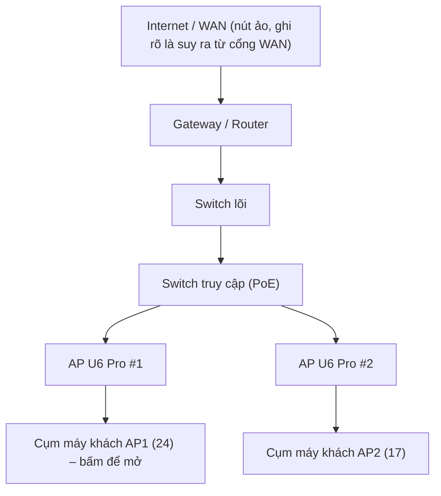
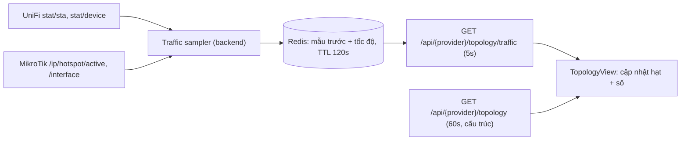

# Kế hoạch tái thiết kế giao diện: Design System · Topology · Giám sát Zabbix

> [!NOTE]
> Bản kế hoạch này ghi lại khảo sát ban đầu. **Đã triển khai mã nguồn; xem kết quả tại Mục 8** và báo cáo nghiệm thu để phân biệt kiểm thử phần mềm với kiểm chứng trên thiết bị thật.

---

## 0. Hiện trạng (kết quả khảo sát)

| Khu vực | Vấn đề quan sát được | Bằng chứng |
|---|---|---|
| Màu sắc | Trộn nhiều họ màu: blue, indigo, purple, violet, emerald, green, rose, red, amber; còn gradient tím | [globals.css](file:///home/jtsc/wifimarketing/src/app/globals.css) có `.btn-gradient-primary` (indigo→violet); focus ring indigo trong khi biến `--admin-blue` là blue. Nhiều màu nhất: [ssids/page.tsx](file:///home/jtsc/wifimarketing/src/app/admin/unifi/ssids/page.tsx), [networks/page.tsx](file:///home/jtsc/wifimarketing/src/app/admin/unifi/networks/page.tsx), [unifi/page.tsx](file:///home/jtsc/wifimarketing/src/app/admin/unifi/page.tsx) |
| Topology – nút | Ô chữ nhật nền pastel theo loại, không icon, không trạng thái, không lưu lượng | [TopologyView.tsx](file:///home/jtsc/wifimarketing/src/components/network/TopologyView.tsx) – `colors` map và `layoutTopology` |
| Topology – chi tiết | Panel phải **đổ nguyên JSON** (`id`, `type`, `meta`…) → cảm giác "fake"/thô | `Object.entries(details).map(...)` trong TopologyView |
| Topology – dữ liệu | UniFi trả `rxBytes/txBytes` cho client & thiết bị, nhưng khi dựng topology **bị bỏ đi**, chỉ giữ `ssid`, `signal` | [topology.ts](file:///home/jtsc/wifimarketing/src/lib/network/topology.ts) `buildUnifiTopology` → `meta:{ssid,signal}`; [unifi.ts](file:///home/jtsc/wifimarketing/src/lib/unifi.ts#L240-L275) `normalizeClient` có đủ trường |
| Topology – MikroTik | Có `bytes-in/bytes-out` ở Hotspot Active nhưng không đưa vào topology | [mikrotik.ts](file:///home/jtsc/wifimarketing/src/lib/mikrotik.ts#L583-L584) |
| Topology – tần suất | Toàn bộ topology tải lại 30s → không đủ để làm hiệu ứng lưu lượng | `setInterval(load, 30000)` |
| Giám sát | Chỉ 2 biểu đồ SVG tự vẽ (CPU, RAM), 3 thẻ đếm, bảng; bảng chi tiết thiết bị là `<pre>JSON</pre>` | [MonitorDashboard.tsx](file:///home/jtsc/wifimarketing/src/components/monitor/MonitorDashboard.tsx) |
| Dữ liệu sẵn có chưa dùng | Collector đã đẩy lên Zabbix: `rx.bytes_sec`, `tx.bytes_sec`, `clients.count`, `devices.count`, `response.ms`, `available`, `uptime.seconds`, `disk.percent` | [collector.ts](file:///home/jtsc/wifimarketing/src/lib/monitor/collector.ts) |
| API metrics | Chỉ 1 target × 1 metric mỗi request; không có API tổng hợp (SLA, phân bố cảnh báo, top-N) | [monitor/api.ts](file:///home/jtsc/wifimarketing/src/lib/monitor/api.ts#L37-L54) |

> [!IMPORTANT]
> Mã nguồn **không có dữ liệu sinh ngẫu nhiên** (`Math.random`) ở phần mạng/giám sát. Cảm giác "FAKE" đến từ: (1) hiển thị JSON thô, (2) bỏ mất số liệu lưu lượng thật, (3) không ghi nguồn & thời điểm đo. Kế hoạch xử lý cả ba.

---

## 1. Design System mới – "Ít màu, nhiều cấp xám"

### 1.1 Nguyên tắc
1. **Một màu nhấn duy nhất**: Blue `#2563EB` (trùng `--admin-blue` đã có). Dùng cho: nút chính, link, tab đang chọn, series dữ liệu chính, nút topology đang chọn.
2. **Màu trạng thái chỉ dùng cho trạng thái**, kích thước nhỏ (chấm 8px, badge viền mảnh): Xanh lá = hoạt động, Hổ phách = cảnh báo, Đỏ = lỗi/ngoại tuyến, Xám = không rõ.
3. **Cấm**: purple / violet / indigo / fuchsia / pink / cyan / teal / orange, mọi gradient trang trí, nền pastel theo loại thiết bị.
4. Phân cấp bằng **độ đậm của xám + khoảng trắng + đường kẻ 1px**, không bằng màu.

### 1.2 Token (CSS variables + Tailwind)

| Token | Giá trị | Dùng cho |
|---|---|---|
| `--ink-900` | `#0F172A` | Tiêu đề, số liệu lớn |
| `--ink-700` | `#334155` | Văn bản thường |
| `--ink-500` | `#64748B` | Nhãn phụ, trục biểu đồ |
| `--ink-300` | `#CBD5E1` | Đường kẻ đậm, đường nối topology không hoạt động |
| `--line` | `#E2E8F0` | Viền thẻ, lưới |
| `--surface` | `#FFFFFF` | Thẻ |
| `--canvas` | `#F8FAFC` | Nền trang, nền canvas topology |
| `--accent` | `#2563EB` | Màu nhấn duy nhất |
| `--accent-soft` | `#EFF6FF` | Nền hover/chọn |
| `--ok` | `#16A34A` | Trạng thái tốt |
| `--warn` | `#D97706` | Cảnh báo |
| `--crit` | `#DC2626` | Lỗi/ngoại tuyến |
| `--muted` | `#94A3B8` | Không xác định |

Biểu đồ: series 1 = `--accent`, series 2 = `--ink-500`, series 3 = `#93C5FD` (blue nhạt). **Tối đa 3 series/biểu đồ.** Download = accent, Upload = ink-500 ở mọi nơi (topology, drawer, Zabbix) để người xem học một lần.

### 1.3 Typography & thành phần
- Font: **Inter** (UI) + **JetBrains Mono** (IP, MAC, port, giá trị kỹ thuật); `font-variant-numeric: tabular-nums` cho mọi con số.
- Thang chữ: 12 / 14 / 16 / 20 / 28. Bỏ bớt các override `font-size !important` trong globals.css sau khi chuẩn hóa.
- Bộ component dùng chung mới trong `src/components/ui/`: `Card`, `StatTile` (số lớn + delta + sparkline), `StatusDot`, `Badge`, `Tabs`, `SegmentedControl` (chọn 1h/6h/24h/7d/30d), `DataTable`, `EmptyState`, `SourceStamp` ("UniFi · 16:42:05 · 5 giây trước").
- Bóng đổ: chỉ 1 mức `0 1px 2px rgb(15 23 42 / .06)`; bo góc 8px thống nhất.

### 1.4 Rào chắn để không "màu mè" trở lại
- Thêm script `npm run lint:colors`: grep chặn `(purple|violet|indigo|fuchsia|pink|cyan|teal|orange)-\d` và `bg-gradient`/`linear-gradient` trong `src/app/admin`, `src/components` (trừ portal/CMS renderer vì là nội dung của khách).
- Thay dần class Tailwind màu cứng bằng token (`bg-accent`, `text-ink-500`, `border-line`).

---

## 2. Topology – mô hình chuẩn & trực quan

### 2.1 Mô hình phân tầng

- **Hạng (rank) cố định theo vai trò**: WAN → Gateway → Switch (theo độ sâu uplink) → AP → Client. Dùng dagre với `rank` ràng buộc để sơ đồ luôn đúng chiều trên-xuống, không lộn xộn khi dữ liệu thay đổi.
- **Gom cụm máy khách** theo AP (mặc định), có thể chuyển "gom theo SSID". Cụm hiển thị: số lượng, tổng ↓/↑ hiện tại. Bấm cụm → mở rộng tại chỗ (tối đa 30 nút, còn lại xem trong drawer).
- **Cạnh**: Có dây = nét liền; Không dây = nét đứt mảnh; Logic (bridge/interface MikroTik) = chấm. Nhãn ở hai đầu cạnh: `Port 5 · 1 Gbps · PoE 6.2 W` (lấy từ `port_table`), không dây: `5 GHz · ch 36 · −58 dBm`.
- **Độ dày cạnh** theo mức sử dụng băng thông khi biết tốc độ cổng (1px → 4px). Không biết tốc độ thì giữ 1.5px.
- Nhóm "Chưa rõ kết nối" giữ nguyên nguyên tắc **không suy đoán đường nối**, nhưng thu gọn thành một khay ở cạnh phải.
- Nút WAN ảo chỉ hiện khi có bằng chứng cổng WAN (UniFi gateway `wan1`, MikroTik interface có default route) và được đánh dấu "suy ra".

### 2.2 Thiết kế nút (custom node)
```
┌──────────────────────────────────────┐
│ [icon]  AP-Tang11-01            ● on │
│         U6 Pro · 10.0.11.21          │
│ ↓ 42.3 Mbps   ↑ 3.1 Mbps   24 khách  │
└──────────────────────────────────────┘
```
- Nền trắng, viền `--line`, icon đơn sắc (lucide: `Globe`, `Router`, `Network`, `Wifi`, `Laptop`/`Smartphone`), chấm trạng thái góc phải.
- Đang chọn: viền `--accent` 2px + vòng mờ. Ngoại tuyến: chữ xám, chấm đỏ, cạnh nối chuyển xám đứt.
- Nút client (khi mở cụm) nhỏ gọn 160×44: tên máy, ↓/↑ hiện tại.

### 2.3 Hiệu ứng gói tin chạy theo đường nối (data-driven)

> [!IMPORTANT]
> Hiệu ứng **phải phản ánh số liệu thật**. Không có số liệu → không chạy hạt. Đây là điều kiện để giao diện không bị "fake".

| Quy tắc | Chi tiết |
|---|---|
| Hai làn | Mỗi cạnh có 2 làn lệch ±3px: **làn download** (cha → con, màu accent), **làn upload** (con → cha, màu ink-500) |
| Mật độ hạt | `count = clamp(ceil(log10(bps) − 3), 0, 5)` → ~1 hạt ở 10 kbps, 5 hạt ở ≥100 Mbps |
| Tốc độ hạt | Thời gian chạy hết cạnh từ 4s (lưu lượng thấp) đến 0.8s (cao), nội suy log |
| Bằng 0 | Không hạt, cạnh tĩnh |
| Không đo được | Cạnh xám đứt, tooltip "Nguồn không cung cấp lưu lượng" |
| Hover cạnh | Tooltip: ↓/↑ hiện tại, tốc độ liên kết, % sử dụng, nguồn & thời điểm đo |

Kỹ thuật:
- Component `TrafficEdge` (custom edge của `@xyflow/react`): dùng `getSmoothStepPath`/`getBezierPath` lấy `d`, vẽ hạt bằng SVG `<circle>` + `<animateMotion>` (GPU-friendly, không re-render React mỗi frame). Làn upload dùng `keyPoints="1;0"`.
- Khi số liệu mới đến, **chỉ thay thuộc tính `dur`/số hạt**, không dựng lại sơ đồ (tách state "cấu trúc" và "lưu lượng").
- Hiệu năng: `onlyRenderVisibleElements`; giới hạn 150 cạnh có hạt (ưu tiên cạnh lưu lượng lớn & cạnh của nút đang chọn); dừng hoạt ảnh khi tab ẩn (`visibilitychange`).
- Tôn trọng `prefers-reduced-motion`: thay hạt bằng mũi tên tĩnh + số liệu.
- Nút "Tạm dừng hiệu ứng" trên thanh công cụ.

### 2.4 Nguồn dữ liệu lưu lượng (thật, có kiểm chứng)



| Thiết bị | Tổng đã dùng | Tốc độ hiện tại | Chiều (cần xác minh Phase 0) |
|---|---|---|---|
| UniFi client | `tx_bytes`, `rx_bytes` | `tx_bytes-r`, `rx_bytes-r` nếu có; nếu không → delta giữa 2 mẫu | Số liệu tính từ phía AP: `tx` = **download của client**, `rx` = **upload** |
| UniFi AP/Switch | `tx_bytes`, `rx_bytes`, `port_table[].rx/tx_bytes` | delta / `*-r` | Theo phía thiết bị |
| MikroTik Hotspot | `bytes-out`, `bytes-in` | delta | Từ phía router: `bytes-out` = download, `bytes-in` = upload |
| MikroTik interface | `rx-byte`, `tx-byte` | delta | Theo phía interface |

Quy tắc trung thực:
- Chuẩn hóa về **góc nhìn người dùng**: `downloadBytes`, `uploadBytes`, `downloadBps`, `uploadBps`.
- Mẫu đầu tiên chưa có delta → hiển thị **"Đang đo…"**, không hiển thị 0.
- Bộ đếm reset (giá trị giảm, client kết nối lại) → bỏ mẫu, không ra số âm.
- Mỗi số đều kèm `source` + `sampledAt`; quá 30s không cập nhật → gắn nhãn "cũ".
- Cache Redis 3s để nhiều tab admin không dội Controller.

### 2.5 Drawer chi tiết khi bấm thiết bị (thay JSON thô)

Drawer phải 400px, 4 tab:

**Máy khách (client)**
- Đầu drawer: tên máy, hostname, OS, chấm trạng thái, "Đã kết nối 1 giờ 12 phút".
- **Thẻ lưu lượng (nổi bật nhất)**:
  - `Đã tải xuống` **1.24 GB** · `Đã tải lên` **86.4 MB** – ghi chú "tính từ lúc kết nối, theo UniFi".
  - `Hiện tại` ↓ 12.3 Mbps · ↑ 0.8 Mbps.
  - Biểu đồ vùng 15 phút gần nhất (bộ đệm phía trình duyệt từ các mẫu 5s) – download accent, upload xám.
  - Nếu MikroTik Hotspot có cùng MAC: hiển thị thêm số liệu phiên Hotspot để đối chiếu (hai nguồn cạnh nhau, không cộng gộp).
- Kết nối: AP, SSID, băng tần, kênh, tín hiệu dBm + mức (Tốt/Khá/Yếu), IP, MAC (mono, nút sao chép), VLAN.
- Liên kết nghiệp vụ: người đã điểm danh với thiết bị này (nếu có), buổi họp.
- "Dữ liệu gốc" (JSON) thu gọn, chỉ cho quyền admin.

**AP**: số khách theo băng tần, tổng ↓/↑, từng radio (kênh, công suất, % sử dụng kênh), **Top 10 khách theo lưu lượng** (bấm để nhảy tới khách), cổng uplink.

**Switch**: bảng cổng (trạng thái, tốc độ, PoE W, ↓/↑, thiết bị nối), sơ đồ mặt trước cổng dạng lưới nhỏ.

**Gateway/Router**: WAN ↓/↑, các interface, số phiên Hotspot, CPU/RAM (link sang trang Giám sát).

**Cạnh (liên kết)**: hai đầu, cổng, tốc độ liên kết, ↓/↑, % sử dụng, bằng chứng (`device.uplink`, `lldp`…) diễn đạt bằng tiếng Việt.

### 2.6 Thanh công cụ & bố cục trang Topology
- Hàng thống kê trên cùng: Gateway · Switch · AP · Khách · **Tổng ↓/↑ hiện tại** (StatTile).
- Toolbar: tìm kiếm (nhảy & phóng tới nút), lọc Lớp, Gom cụm theo AP/SSID, Ẩn khách, Tạm dừng hiệu ứng, Vừa khung, Xuất PNG.
- Chú giải nhỏ cố định góc dưới trái (nét liền/đứt, màu download/upload).
- MiniMap đơn sắc.

---

## 3. Trang Giám sát (Zabbix) – dashboard chuyên nghiệp

### 3.1 Bố cục tab "Tổng quan"
```
┌ Thanh trạng thái nguồn: Collector ● 5s trước · Zabbix 7.0 ● · Redis ● ┐
├ KPI: Khả dụng 30 ngày 99.82% │ Host online 14/15 │ Sự cố đang mở 3 (1 cao) │ Khách WiFi 128 ┤
├ [Lưu lượng mạng ↓/↑ – area chart, 24h]        │ [Sự cố theo mức độ – stacked bar theo giờ] ┤
├ [Số khách WiFi theo thời gian – line]          │ [Thời gian phản hồi dịch vụ – multi-line] ┤
├ [Dải trạng thái khả dụng theo host – status timeline / heatmap 24h]                    ┤
├ [Top 5 CPU] [Top 5 RAM] [Top 5 AP theo lưu lượng] – bảng có sparkline                  ┤
└ [Sự cố đang mở – bảng: mức độ, host, mô tả, thời lượng, đã xác nhận, hành động]        ┘
```

### 3.2 Danh mục biểu đồ

| Biểu đồ | Metric (đã có trong Zabbix) | Kiểu | Ghi chú |
|---|---|---|---|
| Lưu lượng mạng | `rx.bytes_sec`, `tx.bytes_sec` | Area 2 series | Đơn vị tự động bps/Kbps/Mbps |
| CPU / RAM / Disk | `cpu.percent`, `memory.percent`, `disk.percent` | Line + **đường ngưỡng 80%/90%** lấy từ trigger | Vùng vượt ngưỡng tô nhạt |
| Số khách WiFi | `clients.count` | Line/step | Theo controller/site |
| Khả dụng | `available` | Status timeline (dải ngang) | Xanh/đỏ/xám cho khoảng thiếu dữ liệu |
| Phản hồi dịch vụ | `response.ms` (WebUI, Backend, MinIO, PostgreSQL, Redis) | Multi-line (tối đa 3 hiển thị, còn lại bật/tắt) | p95 trong tooltip |
| Sự cố theo thời gian | `event.get` | Stacked bar theo giờ, màu theo mức độ (rút gọn còn 3 mức: Thông tin/Cảnh báo/Nghiêm trọng) | Click cột → lọc bảng |
| SLA | Tính từ `available` (trend) | Số % + thanh | Thời gian thiếu dữ liệu tách riêng, không tính là "lên" |
| Uptime | `uptime.seconds` | Cột trong bảng | "12 ngày 4 giờ" |

Tương tác chung: chọn khoảng thời gian (1h/6h/24h/7d/30d/tùy chọn), **kéo chọn để phóng to**, crosshair đồng bộ giữa các biểu đồ cùng hàng, tooltip có thời điểm + giá trị + đơn vị, khoảng trống dữ liệu hiển thị là khoảng trống (giữ nguyên tắc hiện tại), nhãn nguồn "Zabbix · mẫu gốc / trung bình giờ".

### 3.3 Tab "Thiết bị" (chi tiết 1 host)
- Header: tên, loại, model, IP, trạng thái, uptime, lần thu thập cuối.
- Lưới 2×2: CPU, RAM, Lưu lượng, Số khách (AP).
- Bảng cổng/radio/khách **dạng bảng có cột rõ ràng** (thay `<pre>JSON</pre>` hiện tại).
- Sự cố của riêng host này.

### 3.4 Tab "Cảnh báo"
- Bộ lọc mức độ / trạng thái (đang mở, đã phục hồi) / đã xác nhận.
- Bảng: chấm mức độ, thời điểm, thời lượng, host, mô tả, người xác nhận + ghi chú; xác nhận bằng **modal** (thay `window.prompt`).

### 3.5 Backend cần bổ sung
| API | Mục đích |
|---|---|
| `GET /api/monitor/metrics/batch?targetIds=&metrics=&time=` | Lấy nhiều series một lần (giảm số request từ N×M xuống 1) |
| `GET /api/monitor/summary?time=` | KPI: SLA, số host, sự cố theo mức độ, tổng khách, tổng lưu lượng |
| `GET /api/monitor/top?metric=&limit=5&time=` | Top-N theo giá trị trung bình/max |
| `GET /api/monitor/events/histogram?time=&bucket=1h` | Dữ liệu cột sự cố |
| Mở rộng `metrics` | Trả kèm ngưỡng trigger (`trigger.get` theo item) để vẽ đường ngưỡng |
| Downsampling | Giới hạn ~500 điểm/series (LTTB) trước khi trả về trình duyệt |

---

## 4. Thư viện & kiến trúc frontend

| Hạng mục | Đề xuất | Lý do |
|---|---|---|
| Biểu đồ | **Apache ECharts** (`echarts` + `echarts-for-react`, import theo module) | Trục thời gian chuẩn, dataZoom kéo-chọn, heatmap/status timeline, đồng bộ crosshair, xử lý tốt hàng chục nghìn điểm; dễ áp 1 theme đơn sắc |
| Phương án nhẹ | Recharts | Dễ dùng với React nhưng thiếu dataZoom/heatmap và chậm với nhiều điểm |
| Topology | Giữ `@xyflow/react` + `@dagrejs/dagre` đã có | Đã cài, đủ khả năng custom node/edge |
| Animation UI | `framer-motion` (đã có) cho drawer/tab; **không dùng** cho hạt gói tin (dùng SVG `animateMotion`) | Hiệu năng |

Cấu trúc file dự kiến:
```
src/components/ui/                 Card, StatTile, StatusDot, Badge, Tabs, SegmentedControl, DataTable, SourceStamp
src/components/charts/             theme.ts (theme ECharts đơn sắc), TimeSeriesChart, StatusTimeline, StackedBar, Sparkline
src/components/network/topology/   TopologyCanvas, DeviceNode, ClientClusterNode, TrafficEdge, DetailDrawer/*, Legend, Toolbar, layout.ts, useTraffic.ts
src/lib/network/traffic.ts         chuẩn hóa ↓/↑, tính tốc độ từ delta, phát hiện reset bộ đếm
src/app/api/{unifi,mikrotik}/topology/traffic/route.ts
src/components/monitor/            MonitorDashboard (chia nhỏ), OverviewTab, DeviceTab, AlertsTab, LogsTab
```
Đồng thời tách các file đang viết dồn 1 dòng (TopologyView, MonitorDashboard, topology.ts) thành mã định dạng chuẩn để dễ bảo trì.

---

## 5. Lộ trình triển khai

| Giai đoạn | Nội dung | Kết quả nghiệm thu |
|---|---|---|
| **P0 – Khảo sát dữ liệu (0.5 ngày)** | Gọi thật UniFi & MikroTik: xác nhận có `tx_bytes-r/rx_bytes-r`, chiều tx/rx so với giao diện UniFi gốc, `port_table` có speed/PoE, MikroTik có `bytes-in/out` | Bảng ánh xạ trường đã kiểm chứng bằng ảnh chụp so sánh |
| **P1 – Design system (1.5 ngày)** | Token, font, component `ui/`, theme ECharts, `lint:colors`; thay gradient/indigo toàn admin; dọn 3 trang UniFi nhiều màu nhất | `lint:colors` = 0 vi phạm; ảnh chụp trước/sau |
| **P2 – Dữ liệu lưu lượng (1.5 ngày)** | `traffic.ts`, đưa traffic vào `TopologyNode/Edge`, endpoint `/topology/traffic`, cache Redis, unit test Vitest (delta, reset bộ đếm, mẫu đầu, chiều ↓/↑) | Test xanh; số liệu khớp UniFi UI sai lệch ≤ 1 chu kỳ lấy mẫu |
| **P3 – Topology canvas (2 ngày)** | Layout phân tầng, DeviceNode, ClientClusterNode, nhãn cổng, độ dày cạnh, toolbar, legend, minimap | Sơ đồ đúng chiều trên dữ liệu thật; 300 client vẫn đọc được |
| **P4 – Hiệu ứng gói tin (1 ngày)** | TrafficEdge 2 làn, mapping tốc độ→hạt, reduced-motion, pause, giới hạn hiệu năng | ≥ 50 FPS với 150 cạnh động (Chrome Performance) |
| **P5 – Drawer chi tiết (1.5 ngày)** | 4 loại drawer + drawer cạnh, biểu đồ 15 phút, đối chiếu Hotspot, liên kết điểm danh | Bấm client thấy rõ Đã tải xuống/lên, tốc độ hiện tại, nguồn & thời điểm |
| **P6 – Zabbix backend (1 ngày)** | batch, summary, top, histogram, ngưỡng trigger, downsampling | Trang Tổng quan ≤ 4 request mỗi chu kỳ |
| **P7 – Zabbix dashboard (2.5 ngày)** | Tổng quan, Thiết bị, Cảnh báo (modal xác nhận), Nhật ký theo design system mới | Đủ biểu đồ mục 3.2, có zoom & crosshair |
| **P8 – QA (1 ngày)** | Playwright: bấm nút topology → drawer có số liệu; reduced-motion; responsive 1280/1440/1920; ảnh chụp hồi quy | Báo cáo walkthrough + video ghi lại |

Tổng ước lượng: **~12–13 ngày công**. P1 và P2 có thể làm song song.

---

## 6. Tiêu chí "không fake" áp dụng toàn bộ

1. Mọi con số có **nguồn + thời điểm** (component `SourceStamp`).
2. Không có số liệu → hiển thị "—" + lý do; **không hiển thị 0 thay cho "không biết"**.
3. Hiệu ứng chuyển động chỉ chạy khi có lưu lượng đo được.
4. Không cộng gộp số liệu từ hai nguồn khác nhau (UniFi vs MikroTik) mà hiển thị song song.
5. Nút suy ra (WAN ảo) và liên kết suy ra luôn có nhãn "suy ra".
6. JSON thô chỉ nằm trong mục "Dữ liệu gốc" thu gọn, dành cho admin.

---

## 7. Các quyết định cần bạn chốt

1. **Thư viện biểu đồ**: ECharts (đề xuất) hay Recharts?
2. **Giao diện sáng/tối**: chỉ giao diện sáng (đề xuất, hợp hệ thống quản trị cơ quan), hay thêm chế độ tối cho màn hình NOC/treo tường?
3. **Topology hợp nhất**: giữ 2 sơ đồ riêng UniFi / MikroTik như hiện tại, hay thêm **sơ đồ hợp nhất** (MikroTik gateway → switch → UniFi AP → client, ghép theo MAC)?
4. **Gom cụm client mặc định**: theo AP (đề xuất) hay theo SSID?
5. **Lịch sử lưu lượng từng client**: chỉ 15 phút trong trình duyệt (đề xuất cho đợt này), hay lưu lâu dài (Zabbix/PostgreSQL) để xem lại theo ngày — tốn tài nguyên hơn nhiều khi có hàng trăm thiết bị?
6. **Phạm vi dọn màu**: toàn bộ trang admin, hay ưu tiên Topology + Giám sát + 3 trang UniFi trước?


---

## 8. Kết quả triển khai — 24/10/2026

Đã thực hiện design system, dữ liệu lưu lượng, topology, drawer và dashboard/API giám sát theo P1–P7. Lựa chọn triển khai: ECharts, giao diện sáng, hai sơ đồ riêng, gom theo AP mặc định (đổi được SSID), lịch sử 15 phút trong trình duyệt và dọn màu toàn admin. Nội dung portal/CMS của khách hàng được giữ riêng.

- **Nghiệm thu phần mềm:** build production thành công; TypeScript và rào chắn màu đạt; 263 unit test đạt, 7 test bỏ qua; 29 kiểm thử Playwright đạt trên bản production. Có ảnh 1280/1440/1920 và video thao tác.
- **Điều chỉnh kỹ thuật P4:** cạnh/nhãn vẫn là SVG, hạt dùng một lớp Canvas2D với một vòng rAF để giảm tải so với hàng nghìn `animateMotion`. Giữ quy tắc dữ liệu, chiều/mật độ/tốc độ, giới hạn150 cạnh và điều kiện dừng; benchmark và lý do ghi trong báo cáo.
- **Nguồn thật:** đã đọc UniFi37 thiết bị/18 máy khách và kiểm tra Zabbix7.0.32. Chưa có kết nối MikroTik để kiểm chứng thiết bị; chiều/đơn vị phải được đối chiếu thêm với UI UniFi bằng thử tải trước khi chứng nhận sai lệch≤một chu kỳ.
- **Trạng thái vận hành:** đã build image production `2286e235d718` và khởi động lại frontend (3000), backend (3001) ngày 24/10/2026 theo yêu cầu vận hành. Health API, proxy frontend → backend, kết nối DB và ba ảnh icon HTTP200 đã được xác minh. Không có migration DB riêng cho đợt UI này.

Chi tiết: [Báo cáo triển khai và kiểm thử](docs/ui-redesign-progress.md) · [Hướng dẫn vận hành/API](docs/ui-redesign-operations.md) · [Kiểm chứng dữ liệu thật](docs/ui-redesign-data-validation.md).


### Cập nhật theo phản hồi sơ đồ cây — 24/10/2026

Topology đã đổi sang cây cha–con theo ảnh tham chiếu người vận hành, giữ đúng ba icon thiết bị. Đã sửa lỗi trắng do chu trình uplink và căn viewport trước khi node sẵn sàng, triển khai trên `solutionai.com.vn`. Chi tiết [báo cáo nghiệm thu](docs/topology-blank-fix.md).
